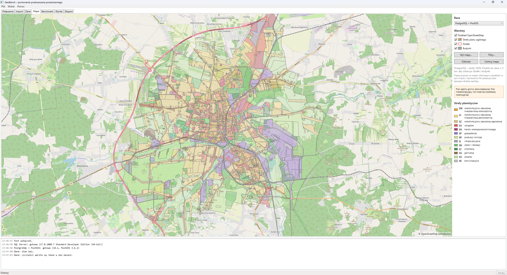
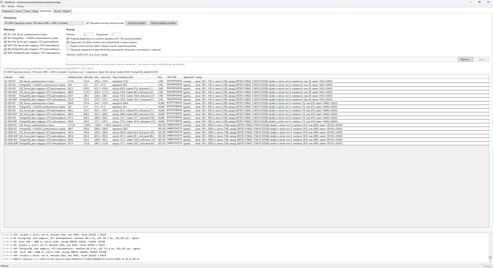
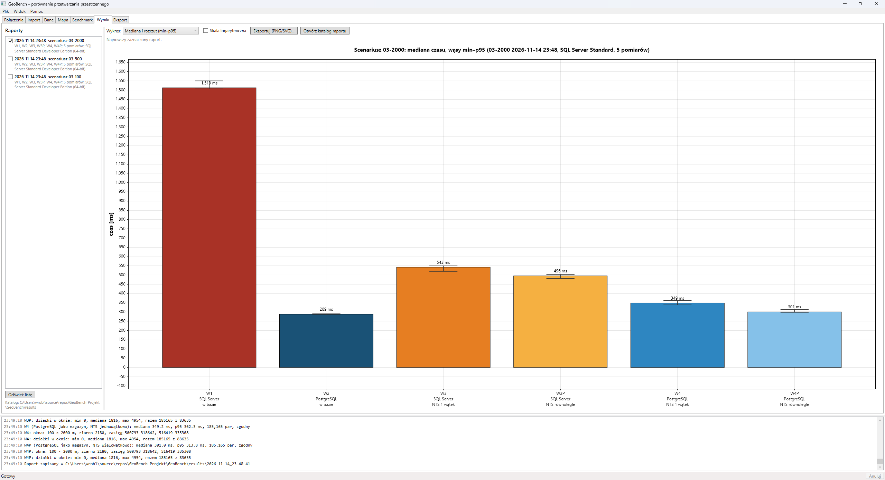

# GeoBench

[](https://github.com/olimo54323/GeoBench-Projekt/actions/workflows/ci.yml)
[](https://olimo54323.github.io/GeoBench-Projekt/)

Aplikacja desktopowa (WPF, .NET 10) porównująca wydajność złączeń przestrzennych wykonywanych:

- w bazie **Microsoft SQL Server** (typ `geometry`),
- w bazie **PostgreSQL + PostGIS**,
- w kodzie C# z biblioteką **NetTopologySuite** (dane odczytane z jednej z baz, jedno- i wielowątkowo).

Dane testowe mają skalę miasta (Częstochowa): ok. 83 tys. działek i 63 tys. budynków z usługi WFS
Ewidencji Gruntów i Budynków oraz ok. 2 tys. stref planistycznych z planu ogólnego gminy (GML, schemat APP 2.0).

> Plan ogólny Częstochowy jest w projekcie wyłącznie **danymi badawczymi**: plan nieobowiązujący
> nie może być podstawą rozstrzygnięć.

## Funkcje

- Asynchroniczne pobieranie działek i budynków z usługi WFS (stronicowanie, cache stron na dysku, ponawianie, kontrola błędów).
- Import planu ogólnego gminy z pliku GML (strefy planistyczne oraz regulacje OUZ i OZS) z przeliczeniem układu współrzędnych do EPSG:2180.
- Zapis do obu baz przez Entity Framework Core: dwóch dostawców za wspólnym modelem i interfejsem magazynu.
- Scenariusze pomiarowe 01–08: ładowanie masowe, przebudowa indeksu, zapytanie oknem, punkt w poligonie,
  nakładanie (pole przecięcia), najbliższy sąsiad, zliczanie w odległości oraz walidacja i naprawa geometrii.
- Sześć wariantów (W1–W4P): przetwarzanie w bazie albo w NTS, z rozgrzewką, wieloma pomiarami, medianą i p95.
- Kontrola poprawności: odcisk SHA-256 zbioru par i porównanie z wzorcem (CSV z QGIS albo pierwszy udany wariant).
- Mapa 2D (Mapsui, podkład OpenStreetMap) z filtrami, stylami i identyfikacją obiektów.
- Raporty JSON i CSV z planami zapytań, wykresy (ScottPlot) z eksportem PNG/SVG, eksport tabel wyników do XLSX, CSV i XML.

## Szybki start

```bash
git clone https://github.com/olimo54323/GeoBench-Projekt.git
cd GeoBench-Projekt/GeoBench
copy appsettings.example.json appsettings.json   # uzupełnij connection stringi
dotnet build GeoBench.slnx
dotnet run --project src/GeoBench.Wpf
```

Szczegóły (wymagania, bazy danych, migracje, testy) są w [instrukcji dla programisty](docs/developer.md).

## Dokumentacja

| Dokument | Zawartość |
|---|---|
| [Instrukcja dla programisty](docs/developer.md) | Wymagania, konfiguracja baz, migracje, budowanie, testy, struktura repozytorium |
| [Instrukcja użytkownika](docs/user-guide.md) | Zakładki aplikacji, scenariusze, warianty, wzorzec z QGIS |
| [Opis API](docs/api.md) | Publiczne API biblioteki GeoBench.Core i używane otwarte API (WFS, OSM, APP) |
| [Biblioteki open source](docs/open-source.md) | Wykorzystane biblioteki i ich licencje |
| [CI/CD](docs/ci.md) | Workflowy GitHub Actions, wydawanie wersji, powiadomienia e-mail |

Pełna dokumentacja z referencją API generowaną z komentarzy XML (DocFX) jest publikowana na
[GitHub Pages](https://olimo54323.github.io/GeoBench-Projekt/).

## Zrzuty ekranu






## Licencja

Kod udostępniony na licencji [MIT](LICENSE). Licencje wykorzystanych bibliotek: [docs/open-source.md](docs/open-source.md).

## Struktura repozytorium

```
GeoBench/
  GeoBench.slnx              rozwiązanie
  appsettings.example.json   wzór konfiguracji (appsettings.json jest poza gitem)
  sources.json               źródła WFS
  sql/<silnik>/scenarios/    zapytania scenariuszy (zasoby osadzone)
  src/GeoBench.Core/         model, import, magazyny, scenariusze, raporty, eksport
  src/GeoBench.Wpf/          aplikacja WPF (MVVM)
  tests/GeoBench.Tests/      testy xUnit (jednostkowe i integracyjne)
docs/                        dokumentacja (markdown + DocFX)
.github/workflows/           GitHub Actions
```
